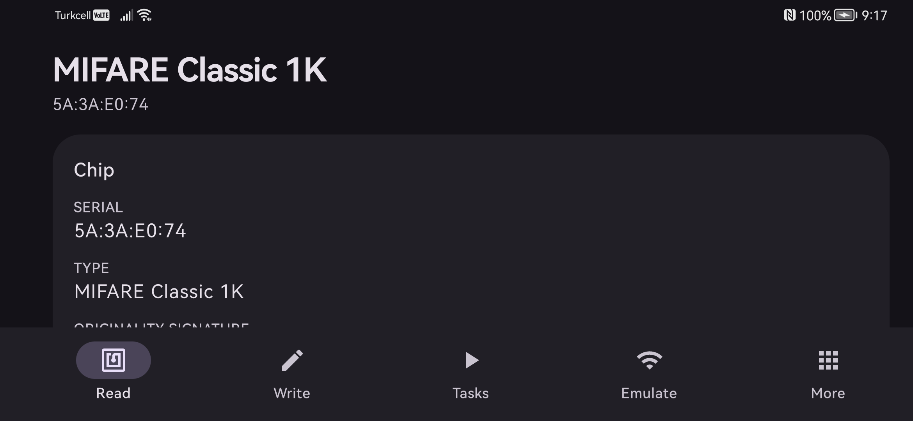
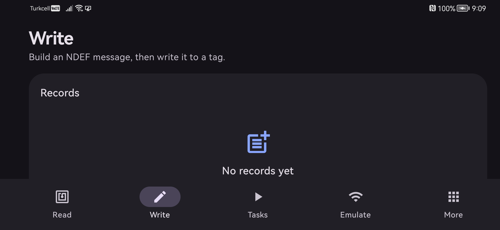
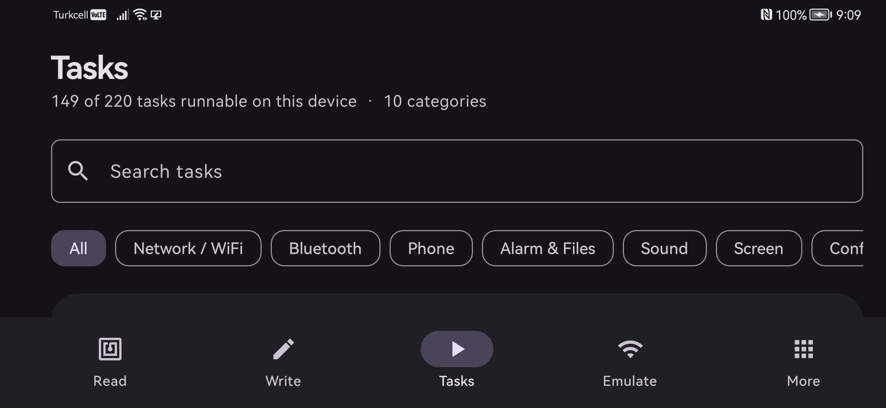
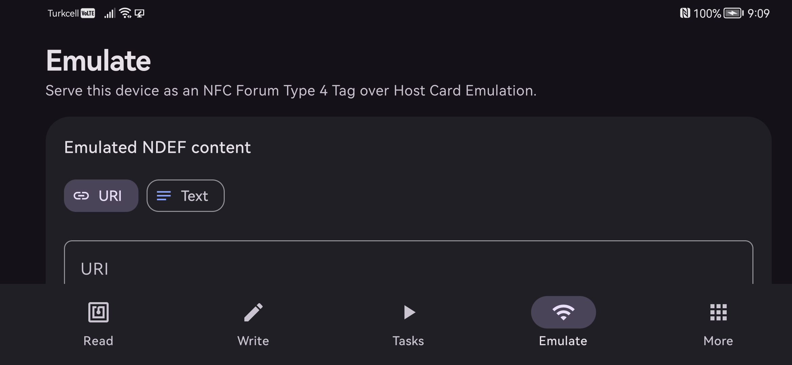
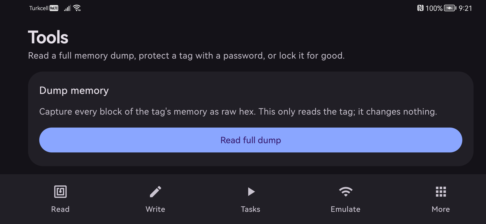
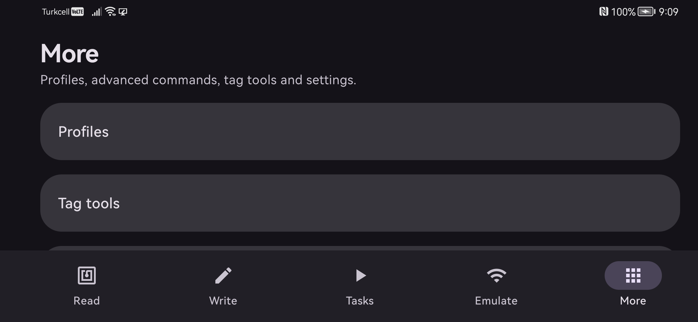

<p align="center">
  
</p>

<p align="center">
  <a href="LICENSE"></a>
  
  
  
  
</p>

<p align="center">
  A modern, ground-up <b>NFC toolkit</b> for Android — read, write, automate, and emulate NFC tags,
  in one clean Jetpack Compose app.
</p>

---

## Screenshots

| Read | Write | Tasks |
|---|---|---|
|  |  |  |

| Emulate | Tools | More |
|---|---|---|
|  |  |  |

## Features

- **Read** — identify the chip (NTAG21x, Ultralight / EV1, MIFARE Classic/Plus, DESFire, ICODE, FeliCa), show the UID, verify the manufacturer **originality signature** (secp128r1 ECDSA, in pure Kotlin — no crypto dependency), and decode the NDEF content.
- **Write** — a record builder across 11 NDEF families (URL, text, Wi-Fi, Bluetooth, contact, email, SMS, geo, app, custom MIME, phone), with a live encoded-size readout and optional lock-after-write.
- **Tasks** — a catalog of **220 automation tasks** across 10 categories (network, Bluetooth, phone, alarm/files, sound, screen, config, apps, conditions, root), a per-parameter builder, and write-to-tag. Dangerous/root tasks are clearly flagged.
- **Run on scan** — scan a tag that carries tasks and run them through a sequence runner (with `if/else/end` conditions). Privileged/root tasks are **deny-by-default**, gated behind a Settings opt-in, an allow-list, and a per-task confirmation dialog.
- **Emulate** — turn the phone into an NFC Forum **Type 4 Tag** over Host Card Emulation (AID `D2760000850101`).
- **Tools** — full memory **dump** (hex grid), **password** protection, and **make-read-only** (with irreversibility guards).
- **Profiles** — save, write, and import/export reusable task profiles as **JSON or CSV**.
- **Advanced** — a raw **APDU / hex console** with command presets.
- **Home-screen widget** and **launcher shortcuts** (deep-link straight to Read / Write / Tasks).
- **No ads, no analytics, no trackers.** The only runtime permission the NFC core needs is `NFC`.

## Architecture

A multi-module Kotlin project with contract-first boundaries (all abstractions live in `:core-model`, so each engine is independently testable):

| Module | Responsibility |
|---|---|
| `core-model` | Contracts + data types (`NfcIo`, `ChipType`, `NdefRecordModel`, `TagWriter`, `TaskExecutor`, `NfcResult`) |
| `core-nfc` | `NfcIoHelper` (transceive + reconnect), `TagReader` (reader mode / foreground dispatch) |
| `core-ndef` | Full NFC Forum NDEF codec |
| `core-chip` | Chip identification pipeline + originality-signature verification |
| `core-tag` | Write / format / lock / password / dump engine |
| `feature-tasks` | 220-task catalog, executors, condition flow, SSRF-filtered HTTP, root shell (guarded) |
| `feature-hce` | Type 4 Tag emulation |
| `feature-profiles` | Profile persistence + JSON/CSV import-export |
| `app` | Compose UI (Material 3, dynamic color), navigation, DI, tap routing |

## Build & run

Requires JDK 17 and the Android SDK (compileSdk 36).

```bash
git clone https://github.com/efekurucay/nfcraft.git
cd nfcraft
./gradlew :app:assembleDebug
# APK at app/build/outputs/apk/debug/app-debug.apk
adb install -r app/build/outputs/apk/debug/app-debug.apk
```

Or grab a prebuilt APK from the [Releases](https://github.com/efekurucay/nfcraft/releases) page.

## Status

Builds and runs; all screens render; tested on a device (real MIFARE Classic 1K read + chip identification verified end-to-end). Some tag-touching operations (password/lock, DESFire dump, HCE) need their specific tag types to exercise fully — see [STATUS.md](STATUS.md) for the per-area notes and on-device verification list.

## Safety

NFCraft can run powerful actions. **Root / dangerous tasks are disabled by default** and never execute without an explicit opt-in *and* a per-run confirmation. `make-read-only` and `set-password` permanently alter a tag — the app warns before each. Only run tasks from tags you trust.

## Disclaimer

NFCraft is an independent, clean implementation built on open NFC Forum standards and public chip datasheets. It is **not affiliated with, nor derived from the source code of, any commercial NFC app or chip vendor.** Embedded manufacturer public keys are the vendors' published originality-verification keys. Use responsibly and only on tags and devices you own or are authorized to modify.

## License

[MIT](LICENSE) © Yahya Efe Kuruçay
